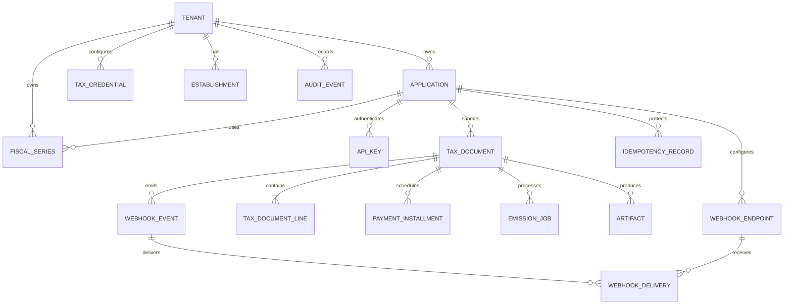
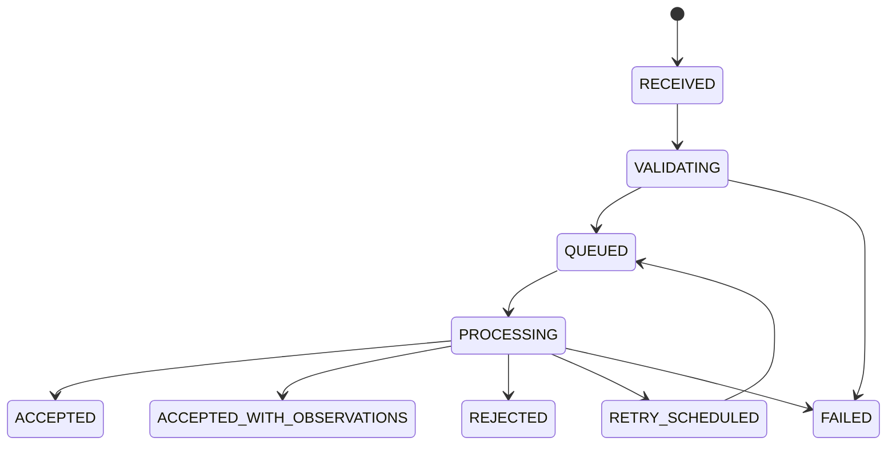

# Modelo de datos v1

## Objetivo

El modelo pertenece exclusivamente a Nuvex Billing API. Ninguna entidad depende de tablas de ventas, productos, clientes o usuarios de Nuvex. Los datos del emisor, receptor y líneas se almacenan como una fotografía inmutable del momento de emisión.

## Decisiones principales

1. El servicio es multiempresa y cada registro operativo tiene `tenant_id` directo o derivable de forma inequívoca.
2. Una API key identifica una aplicación y un ambiente (`BETA` o `PRODUCTION`).
3. Las credenciales SOL y las contraseñas de certificados se cifran; las API keys y secretos de webhook se almacenan mediante hash cuando no sea necesario recuperar el valor original.
4. La numeración fiscal pertenece al microservicio. Una serie se asigna a una sola aplicación por ambiente para evitar colisiones.
5. `application_id + idempotency_key` es único. Repetir la misma operación devuelve el resultado original; reutilizar la clave con otro payload devuelve `409`.
6. `application_id + external_id` es único para documentos activos.
7. El payload original, el payload normalizado y el resultado tributario se conservan para auditoría.
8. Los importes se almacenan como `DECIMAL`, nunca `float` o `double`.
9. XML, ZIP, CDR, PDF A4 y PDF ticket viven en almacenamiento S3/R2; PostgreSQL guarda metadatos y claves privadas, nunca URLs públicas permanentes.
10. Los estados aceptados o rechazados por SUNAT son terminales. Un documento fiscal emitido no se sobrescribe.

## Relaciones

## Entidades

### `tenant`

Representa al contribuyente que emite documentos.

| Campo | Tipo | Regla |
|---|---|---|
| `id` | UUID/CUID2 | PK |
| `ruc` | VARCHAR(11) | Único |
| `legal_name` | VARCHAR(200) | Obligatorio |
| `trade_name` | VARCHAR(200) | Opcional |
| `address` | VARCHAR(255) | Obligatorio para emisión |
| `ubigeo` | VARCHAR(6) | Obligatorio para emisión |
| `status` | ENUM | `ACTIVE`, `SUSPENDED` |
| `created_at` | TIMESTAMPTZ | |
| `updated_at` | TIMESTAMPTZ | |

### `application`

Sistema autorizado a facturar para un tenant: Nuvex, un POS u otra aplicación.

| Campo | Tipo | Regla |
|---|---|---|
| `id` | UUID/CUID2 | PK |
| `tenant_id` | FK | Obligatorio |
| `name` | VARCHAR(120) | Obligatorio |
| `code` | VARCHAR(50) | Único dentro del tenant |
| `status` | ENUM | `ACTIVE`, `DISABLED` |
| `created_at` | TIMESTAMPTZ | |

### `api_key`

| Campo | Tipo | Regla |
|---|---|---|
| `id` | UUID/CUID2 | PK |
| `application_id` | FK | Obligatorio |
| `environment` | ENUM | Aísla BETA y PRODUCTION |
| `environment` | ENUM | `BETA`, `PRODUCTION` |
| `prefix` | VARCHAR(20) | Identificación visible |
| `secret_hash` | VARCHAR(255) | Nunca guardar la key completa |
| `scopes` | TEXT[]/JSON | Ej. `documents:write` |
| `last_used_at` | TIMESTAMPTZ | Opcional |
| `expires_at` | TIMESTAMPTZ | Opcional |
| `revoked_at` | TIMESTAMPTZ | Opcional |

### `tax_credential`

Una configuración por tenant y ambiente.

| Campo | Tipo | Regla |
|---|---|---|
| `id` | UUID/CUID2 | PK |
| `tenant_id` | FK | Obligatorio |
| `environment` | ENUM | Único con tenant |
| `sol_username_encrypted` | TEXT | Cifrado autenticado |
| `sol_password_encrypted` | TEXT | Cifrado autenticado |
| `client_id_encrypted` | TEXT | Reservado para GRE/SIRE |
| `client_secret_encrypted` | TEXT | Reservado para GRE/SIRE |
| `certificate_object_key` | VARCHAR(600) | Privado |
| `certificate_password_encrypted` | TEXT | Cifrado autenticado |
| `certificate_serial_number` | VARCHAR(128) | Serie X.509 |
| `certificate_subject` | TEXT | Sujeto X.509 |
| `certificate_issuer` | TEXT | Emisor X.509 |
| `certificate_valid_from` | TIMESTAMPTZ | Inicio de vigencia |
| `certificate_fingerprint` | VARCHAR(128) | Auditoría |
| `certificate_expires_at` | TIMESTAMPTZ | Alertas |
| `active` | BOOLEAN | |
| `updated_at` | TIMESTAMPTZ | |

Restricción única: `(tenant_id, environment)`.

### `establishment`

| Campo | Tipo | Regla |
|---|---|---|
| `id` | UUID/CUID2 | PK |
| `tenant_id` | FK | Obligatorio |
| `code` | VARCHAR(10) | Código SUNAT |
| `name` | VARCHAR(120) | |
| `address` | VARCHAR(255) | |
| `ubigeo` | VARCHAR(6) | |
| `active` | BOOLEAN | |

Restricción única: `(tenant_id, code)`.

### `fiscal_series`

La fila debe bloquearse durante la asignación del siguiente número.

| Campo | Tipo | Regla |
|---|---|---|
| `id` | UUID/CUID2 | PK |
| `tenant_id` | FK | Obligatorio |
| `application_id` | FK | Propietaria de la serie |
| `establishment_id` | FK | Obligatorio |
| `environment` | ENUM | `BETA`, `PRODUCTION` |
| `document_type` | ENUM | `INVOICE`, `RECEIPT`, `CREDIT_NOTE`, `DEBIT_NOTE` |
| `series` | VARCHAR(4) | `F...` o `B...` |
| `current_number` | INTEGER | Incremento transaccional |
| `active` | BOOLEAN | |

Restricción única: `(tenant_id, environment, document_type, series)`.

### `tax_document`

Documento fiscal y fotografía inmutable para emisión.

| Campo | Tipo | Regla |
|---|---|---|
| `id` | UUID/CUID2 | PK público |
| `tenant_id` | FK | Obligatorio |
| `application_id` | FK | Obligatorio |
| `external_id` | VARCHAR(100) | ID en el sistema origen |
| `environment` | ENUM | Derivado de API key |
| `document_type` | ENUM | `INVOICE`, `RECEIPT`, `CREDIT_NOTE`, `DEBIT_NOTE` |
| `series_id` | FK | Obligatorio |
| `series` | VARCHAR(4) | Snapshot |
| `number` | INTEGER | Asignado por el servicio |
| `issue_date` | DATE | Explícito, no usar `created_at` |
| `issue_time` | TIME | Opcional |
| `currency` | CHAR(3) | ISO 4217 |
| `payment_method` | ENUM | `CASH`, `CREDIT` |
| `calculation_version` | VARCHAR(40) | Política tributaria inmutable usada |
| `status` | ENUM | Estado API |
| `issuer_snapshot` | JSONB | RUC, razón social y dirección |
| `customer_snapshot` | JSONB | Documento, nombre y dirección |
| `request_payload` | JSONB | Solicitud original |
| `normalized_payload` | JSONB | Entrada canónica validada |
| `metadata` | JSONB | Máximo 20 valores escalares |
| `taxable_amount` | DECIMAL(18,2) | |
| `exempt_amount` | DECIMAL(18,2) | |
| `unaffected_amount` | DECIMAL(18,2) | |
| `discount_amount` | DECIMAL(18,2) | |
| `tax_amount` | DECIMAL(18,2) | |
| `total_amount` | DECIMAL(18,2) | |
| `sunat_code` | VARCHAR(40) | Opcional |
| `sunat_message` | VARCHAR(1000) | Opcional |
| `sunat_observations` | TEXT[] | Observaciones estructuradas del CDR; vacío por defecto |
| `sunat_hash` | VARCHAR(128) | Opcional |
| `submitted_at` | TIMESTAMPTZ | Opcional |
| `responded_at` | TIMESTAMPTZ | Opcional |
| `created_at` | TIMESTAMPTZ | |
| `updated_at` | TIMESTAMPTZ | |
| `version` | INTEGER | Control optimista |

Restricciones:

- Única `(application_id, external_id)`.
- Única `(tenant_id, environment, document_type, series, number)`.
- Los snapshots y líneas no cambian después de entrar a `PROCESSING`.

### `tax_document_line`

| Campo | Tipo | Regla |
|---|---|---|
| `id` | UUID/CUID2 | PK |
| `document_id` | FK | Obligatorio |
| `line_number` | INTEGER | Único dentro del documento |
| `external_id` | VARCHAR(100) | Referencia del origen |
| `sku` | VARCHAR(60) | Opcional |
| `description` | VARCHAR(500) | Obligatorio |
| `unit_code` | VARCHAR(10) | Catálogo SUNAT |
| `quantity` | DECIMAL(18,10) | Mayor que cero |
| `unit_price` | DECIMAL(18,10) | Precio recibido |
| `unit_price_includes_tax` | BOOLEAN | |
| `tax_affectation_code` | VARCHAR(4) | Catálogo SUNAT |
| `unit_value` | DECIMAL(18,10) | Calculado |
| `discount_amount` | DECIMAL(18,2) | Calculado |
| `line_value` | DECIMAL(18,2) | Calculado |
| `tax_amount` | DECIMAL(18,2) | Calculado |
| `total_amount` | DECIMAL(18,2) | Calculado |

### `payment_installment`

Solo se usa cuando `payment_method = CREDIT`.

| Campo | Tipo | Regla |
|---|---|---|
| `id` | UUID/CUID2 | PK |
| `document_id` | FK | Obligatorio |
| `number` | INTEGER | Único por documento |
| `amount` | DECIMAL(18,2) | Mayor que cero |
| `due_date` | DATE | No anterior a emisión |

La suma de cuotas debe coincidir con el saldo a crédito.

### `idempotency_record`

| Campo | Tipo | Regla |
|---|---|---|
| `id` | UUID/CUID2 | PK |
| `application_id` | FK | Obligatorio |
| `key` | VARCHAR(100) | Obligatorio |
| `request_hash` | VARCHAR(128) | SHA-256 del payload canónico |
| `resource_type` | VARCHAR(50) | Ej. `tax_document` |
| `resource_id` | VARCHAR(100) | Resultado |
| `response_status` | INTEGER | |
| `response_body` | JSONB | Respuesta reproducible |
| `expires_at` | TIMESTAMPTZ | Retención definida |

Restricción única: `(application_id, key)`.

### `emission_job`

| Campo | Tipo | Regla |
|---|---|---|
| `id` | UUID/CUID2 | PK |
| `document_id` | FK | Obligatorio |
| `operation` | ENUM | Inicialmente `ISSUE` |
| `status` | ENUM | `PENDING`, `PROCESSING`, `DONE`, `DEAD` |
| `attempts` | INTEGER | |
| `max_attempts` | INTEGER | Default 10 |
| `next_attempt_at` | TIMESTAMPTZ | |
| `locked_at` | TIMESTAMPTZ | Lock recuperable |
| `locked_by` | VARCHAR(100) | Worker |
| `last_error_code` | VARCHAR(40) | |
| `last_error_message` | VARCHAR(1000) | |
| `created_at` | TIMESTAMPTZ | |
| `processed_at` | TIMESTAMPTZ | Opcional |

Índice de extracción: `(status, next_attempt_at)`.

Índice único parcial para impedir trabajos activos duplicados:
`(document_id, operation) WHERE status IN ('PENDING', 'PROCESSING')`.

### `artifact`

| Campo | Tipo | Regla |
|---|---|---|
| `id` | UUID/CUID2 | PK |
| `document_id` | FK | Obligatorio |
| `type` | ENUM | `XML`, `ZIP`, `CDR`, `PDF` (histórico), `PDF_A4`, `PDF_TICKET` |
| `object_key` | VARCHAR(600) | Privado |
| `file_name` | VARCHAR(255) | |
| `content_type` | VARCHAR(100) | |
| `size_bytes` | BIGINT | |
| `sha256` | VARCHAR(64) | Integridad |
| `created_at` | TIMESTAMPTZ | |

Restricción única: `(document_id, type)`.

### `webhook_endpoint`

| Campo | Tipo | Regla |
|---|---|---|
| `id` | UUID/CUID2 | PK |
| `application_id` | FK | Obligatorio |
| `url` | VARCHAR(500) | Solo HTTPS público |
| `event_types` | TEXT[]/JSON | Eventos suscritos |
| `signing_secret_encrypted` | TEXT | Debe recuperarse para firmar HMAC |
| `active` | BOOLEAN | |
| `created_at` | TIMESTAMPTZ | |

### `webhook_event`

Evento inmutable producido dentro de la misma transacción que cambia el estado del documento.

| Campo | Tipo | Regla |
|---|---|---|
| `id` | UUID/CUID2 | PK y `eventId` público |
| `document_id` | FK | Obligatorio |
| `event_type` | VARCHAR(80) | |
| `payload` | JSONB | Snapshot del evento |
| `created_at` | TIMESTAMPTZ | |

### `webhook_delivery`

| Campo | Tipo | Regla |
|---|---|---|
| `id` | UUID/CUID2 | PK |
| `event_id` | FK | Obligatorio |
| `endpoint_id` | FK | Obligatorio |
| `status` | ENUM | `PENDING`, `PROCESSING`, `DELIVERED`, `DEAD` |
| `attempts` | INTEGER | |
| `max_attempts` | INTEGER | Límite de intentos |
| `next_attempt_at` | TIMESTAMPTZ | |
| `locked_at` / `locked_by` | TIMESTAMPTZ / VARCHAR | Lock recuperable del worker |
| `last_http_status` | INTEGER | Opcional |
| `last_error` | VARCHAR(1000) | Opcional |
| `delivered_at` | TIMESTAMPTZ | Opcional |

Restricción única: `(event_id, endpoint_id)`.

### `audit_event`

| Campo | Tipo | Regla |
|---|---|---|
| `id` | UUID/CUID2 | PK |
| `tenant_id` | FK | Obligatorio |
| `application_id` | FK | Opcional |
| `actor_type` | ENUM | `API_KEY`, `ADMIN`, `SYSTEM` |
| `actor_id` | VARCHAR(100) | |
| `action` | VARCHAR(100) | |
| `resource_type` | VARCHAR(80) | |
| `resource_id` | VARCHAR(100) | |
| `request_id` | VARCHAR(100) | Correlación |
| `ip` | INET | Opcional |
| `data` | JSONB | Sin secretos |
| `created_at` | TIMESTAMPTZ | Inmutable |

## Máquina de estados del documento

`ACCEPTED`, `ACCEPTED_WITH_OBSERVATIONS`, `REJECTED` y `FAILED` definitivo son estados terminales para la operación de emisión. Una futura nota de crédito o baja será un documento/operación nueva, no una edición destructiva.

## Transacción de creación

Una única transacción PostgreSQL debe:

1. Bloquear y avanzar `fiscal_series.current_number`.
2. Crear `idempotency_record`.
3. Crear `tax_document`, líneas y cuotas.
4. Crear `emission_job` en estado `PENDING`.
5. Crear el primer `audit_event`.

Si cualquiera falla, nada debe persistir y el número fiscal no debe quedar asignado parcialmente.

## Retención y datos sensibles

- Nunca registrar claves SOL, certificados, API keys o secretos de webhook en logs.
- Los enlaces de descarga deben ser firmados y expirar.
- Los artefactos deben conservar hash SHA-256.
- Los backups deben estar cifrados.
- La política exacta de retención tributaria se definirá antes de producción.
